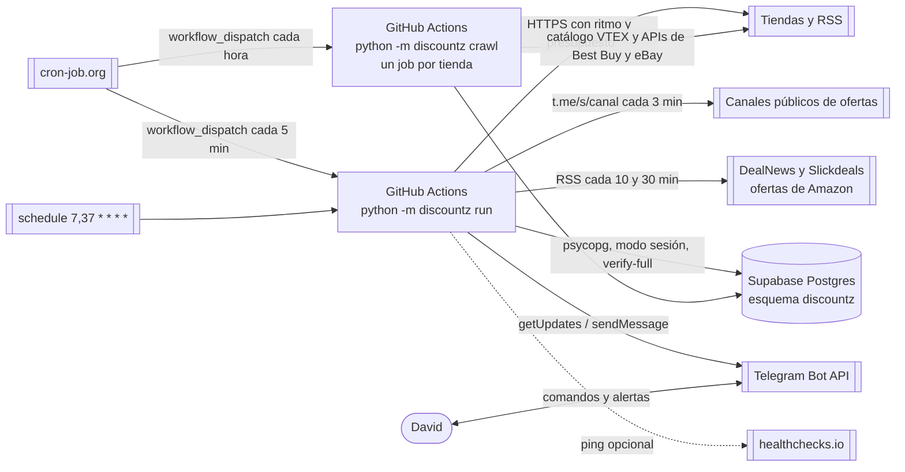

# Arquitectura de discountZ

## Contexto
Monitor **personal** de ofertas para David (Colombia). Rastrea tiendas colombianas (COP) y de EE. UU. que envían a casillero (USD), filtra descuentos inflados con un histórico propio y avisa por Telegram. Escala: decenas a pocos cientos de productos, un solo usuario, costo $0. Diseño completo: `docs/superpowers/specs/2026-10-13-discountz-v1-design.md`; decisiones en `docs/decisions/`.

Sistemas externos: GitHub Actions (cómputo), cron-job.org (disparo cada 5 min), Supabase Postgres (estado), Telegram Bot API (alertas y comandos), tiendas (VTEX ×6, Algolia de Alkosto, Amazon US, Newegg, Walmart, Best Buy, eBay por la Browse API), el RSS de Slickdeals y el RSS de Amazon de DealNews.

## Contenedores

## Estilo y módulos
Monolito modular hexagonal-lite **síncrono** (ADR 0001). Paquete `src/discountz/`:

| Módulo | Responsabilidad |
|---|---|
| `domain/` | Puro: `Money`, modelo, `SafeUrl`, segmentos, estadísticos, guardas, `evaluate`, `decide`, comandos, planificador, salud, ofertas de canales (`community`), perfil de temas (`topics`) e intereses (`interests`). Sin I/O, reloj ni azar del sistema |
| `infra/` | HTTP (`PacedClient` como Decorator), BD (Repository de funciones), migraciones, Telegram, logs, healthchecks |
| `sources/` | Contrato `Source`, registro (`SOURCES`, `route_url`), detección de bloqueos y un adaptador por plataforma (incluidos los canales de Telegram, `kind="channel"`) |
| `app/` | Casos de uso: ciclo (bandeja de entrada, recolección, confirmación, composición, entrega, mantenimiento, render), rastreo del catálogo (`crawl`), tope de tarjetas del día (`held`) e intereses activos (`interests`) |
| `__main__.py` | Composition root y CLI: `run`, `crawl`, `migrate`, `check-config`, `record-fixture` |

Regla de dependencias `app → sources → infra → domain`, comprobada por import-linter en pre-commit y CI:

| Contrato | Tipo | Qué impide |
|---|---|---|
| «Capas» | `layers` | Que una capa importe otra superior |
| «Dominio puro» | `forbidden` | Que `domain` importe `httpx`, `curl_cffi`, `psycopg`, `selectolax`, `pydantic`, `pydantic_settings` o `defusedxml` |
| «Adaptadores independientes» | `independence` | Que un adaptador de `sources/` importe otro |

Además, ruff `TID251` prohíbe `datetime.now`, `utcnow`, `date.today`, `time.time` y `random.random` fuera de `__main__.py` e `infra/http.py`, y ruff `DTZ` prohíbe los datetime naive: `now` se calcula una vez y viaja como parámetro.

## Modelo de datos
Esquema `discountz` (migración `0001_init`):

- `source`: catálogo de fuentes con breaker, salud, rampa y cuarentena.
- `source_hourly_stat`: contadores por hora (presupuesto de 24 h, salud, `/estado`).
- `listing`: una variante vendible en una fuente (`UNIQUE (source, external_id)`), último precio, mínimo histórico robusto, `hot_until`.
- `price_segment`: histórico por segmentos de estado constante, PK `(listing_id, started_at)`, un solo segmento abierto por listing.
- `watch` (seguimiento `pNN`) y `search` (búsqueda `bNN`).
- `alert`: hecho de dominio con `UNIQUE (listing_id, segment_started_at, kind)`.
- `outbox`: todo mensaje saliente con `dedup_key` único.
- `bot_state`, `run_lease`, `run`: singletons de operación, lease con TTL y registro de ciclos.
- `schema_migrations`: versión y sha256 de cada migración aplicada.

Migración `0002_catalogo` (rastreo):

- `catalog_item`: un producto del catálogo, solo números (precio, «antes» estable, mínimo, EAN, tema); título y foto se leen al alertar.
- `catalog_price_change`: cambios de precio; dejó de escribirse en el PR #31 y la migración `0011` la borró junto con el catálogo de Carulla y Olímpica (apagadas).
- `crawl_cursor` y `crawl_lease`: dónde va la vuelta de cada tienda (partición, página, bandas de precio partidas, peticiones del día) y quién la corre.
- `topic`: tema del grupo de Telegram por código y su `message_thread_id`.
- `outbox` gana `topic` y `card` (datos de la tarjeta); `watch` gana `origin` (`manual`/`auto`) y `expires_at`.

Migración `0003_canales` (canales de Telegram, ADR 0005):

- `channel_cursor`: último id leído de cada canal.
- `channel_post`: ofertas leídas de los canales (7 días), con `duplicate_of` cuando ya llegó la misma oferta por otro canal.
- `source.kind` admite `channel`.

Migración `0004_feeds_web` (feeds de Amazon, ADR 0006): fuentes `dealnews` y `slickdeals_amazon`, y `channel_post.baseline` para las ofertas que la primera lectura de un feed deja vistas sin enviar.

Migración `0005_ebay` (ADR 0008): fuente `ebay_us`, `catalog_item.model_key` (el `epid` de eBay, con índice parcial) y `alert.kind = 'model_low'`.

Migración `0007_alkosto` (ADR 0009): fuente `alkosto` (`sources/alkosto.py`), que lee el índice público de Algolia de la tienda.

Migración `0008_jumbo_pepeganga`: fuentes `jumbo` y `pepeganga`, dos tiendas VTEX más (`STORES` en `sources/vtex.py`).

Migración `0009_min_seen_at`: `catalog_item.min_seen_at`; el mínimo de precios estables vence a los 90 días (`domain/catalog.py`, `MIN_WINDOW`).

Migración `0010_tope_diario` (ADR 0012): `offer_log`, cada oferta del rastreo y de los canales frente al tope del día (en tarjeta, o retenida con su línea para el resumen de las 21:00), y `alert.delivery = 'held'`.

Migración `0012_intereses` (spec del perfil §3, ADR 0013): `interest`, los intereses personales de `/interes` (la semilla vive en `config/interests.toml`), y `offer_log.interest`, el interés cuyo tope usó la tarjeta (NULL si usó el de la fuente).

Dinero en `bigint` de unidad menor (COP exponente 0, USD exponente 2), porcentajes en puntos básicos e instantes en `timestamptz` UTC.

## Flujos clave
1. **Ciclo** (`python -m discountz run`, spec §1.3):
   1. Arranque: `now`, configuración validada, logs con redacción.
   2. Conexión a la BD (3 intentos) y verificación de `SCHEMA_VERSION`.
   3. Lease con TTL de 16 min; si está tomado, `skipped_locked`.
   4. Registro del `run` y recuperación del outbox atascado.
   5. Bandeja de entrada de Telegram (comandos idempotentes; nunca HTTP a tiendas).
   6. Plan puro por fuente: breaker, presupuestos, prioridades y modo caliente.
   7. Recolección por turnos rotativos: fetch → histórico → `evaluate()` → transacción corta.
   8. Confirmación por fuente (tormenta, ruta independiente o persistencia) y creación de alertas.
   9. Composición al outbox, segunda pasada de la bandeja y entrega (≤ 15 mensajes).
   10. Mantenimiento diario, resumen de las 08:00, contadores, cierre y liberación del lease.
2. **Comando `/seguir`**: crea un `watch` pendiente sin HTTP → el plan lo resuelve → la primera lectura crea el `listing` y encola la respuesta.
3. **Rastreo** (`python -m discountz crawl --source <tienda>`, un job por tienda cada hora):
   1. Breaker abierto ⇒ `blocked`; tienda apagada (o Éxito y Carulla con la BD en ≥ 450 MB) ⇒ `disabled`; lease por tienda.
   2. Capa caliente (≤ 25 % del presupuesto): `fetch_changed` en Best Buy, relectura de lo que cambió hace poco en VTEX (sin los temas `off` del perfil, ADR 0013).
   3. Barrido desde el cursor: particiones por categoría raíz y, si pasan de 2.500 productos, bandas de precio partidas a demanda. Se saltan las particiones de temas `off` del perfil (`domain/topics.py`, ADR 0013).
   4. Cada página va a `domain/catalog.py` (puro); en eBay también se compara con la mediana de las publicaciones del mismo modelo (`model_candidate`, ADR 0008); una bajada real contra el «antes» estable se confirma en la ficha (±1 %, stock, vendedor) y se descarta si otra tienda alertó el mismo EAN.
   5. Solo se confirma lo de un tema `card` del perfil o lo que coincide con un interés, que se detecta sin los mínimos de precio y de ahorro (ADR 0013, `domain/interests.py`). `app/held.py` decide si sale en tarjeta: 8 por tienda al día y 3 por interés (con ese tope lleno, lo que también saldría sin el interés usa el de la tienda); lo demás va al resumen de las 21:00. La alerta entra a `outbox` con su tema y su tarjeta; el ciclo la entrega como foto (`sendPhoto`) en ese tema.
4. **Feed de Slickdeals**: una tarea `feed` baja el RSS una vez para todas las búsquedas `source='slickdeals'` vencidas → cada lead que coincide y apunta a una tienda activa (sin red: `href`, `u2=` o `data-aps-asin`) encola en memoria una lectura de ficha en esa tienda, antes que sus demás tareas → `evaluate(origin="lead")` puede dar `COMMUNITY_DEAL`. Los leads no se guardan, pero todo lead que lleva a una ficha crea un seguimiento automático (`aNN`, 30 días sin alerta, tope por tienda).

5. **Canales de Telegram** (`app/channels.py`, dentro del ciclo): cada canal que toca (3 min) baja hasta 3 páginas `t.me/s/<canal>?after=<cursor>` con `sources/telegram_channels.py` → `domain/community.py` descarta duplicados (mismo cupón, o precio a ±10 % y títulos parecidos, 24 h) y asigna el tema → lo de un tema que no es `card` del perfil queda visto (`baseline`) sin enviarse, salvo que coincida con un interés (ADR 0013) → por página, en una transacción: guarda las publicaciones, encola la tarjeta «sin verificar» en `outbox` (o la retiene para el resumen con el tope del día de `app/held.py`, como en el rastreo) y avanza el cursor. La primera lectura solo fija el cursor. Los feeds de Amazon (`sources/dealnews.py` cada 10 min y `slickdeals_amazon` cada 30) son canales con `ordered_ids=False`: se releen enteros, se saltan los ids ya guardados y su primera lectura marca lo que hay con `baseline` (ADR 0006).

## Atributos de calidad
1. **Corrección de alertas**: ninguna alerta por un error de parseo o un descuento inflado (guardas G1-G14, confirmación independiente, tabla U01-U37).
2. **Costo**: $0 (Actions público, Supabase free < 500 MB).
3. **Frescura**: latencia de alerta ~5-8 min (disparo externo, modo caliente).
4. **Seguridad**: repo y logs públicos sin secretos ni datos personales; mínimo privilegio en BD; Telegram solo del dueño.
5. **Robustez**: cada fuente aislada (breaker persistido); outbox y bandeja idempotentes.
6. **Mantenibilidad**: dominio puro con TDD; agregar una tienda no toca `domain/` ni `app/`.

## Riesgos y deuda técnica
- Relámpagos más cortos que la cadencia efectiva se pierden · aceptado.
- Producto descubierto durante una inflación sin histórico previo puede dar `GOOD_DEAL` con `short_history` (U05) · aceptado.
- Promociones recurrentes que ocupan > 10 % del tiempo no se avisan, salvo con objetivo (U33) · aceptado.
- `R = mín(…)` da falsos negativos en mercados al alza · modo `recent` en v1.1 si hay > 3 reportes.
- Una tienda sin ruta independiente nunca confirma un patrón 10^k (U12) · aceptado.
- IPs de Azure: cualquier tienda puede volverse inviable sin proxies · breaker + salud lo hacen visible; plan B local.
- Términos de uso de Actions y de las tiendas · ritmo conservador, sin evasión.
- Un mensaje duplicado si el proceso cae entre la API de Telegram y el commit · aceptado (at-least-once).
- Comandos perdidos tras más de 24 h de caída · healthchecks avisa.
- El `ListPrice` de VTEX está inflado en el marketplace: el rastreo nunca lo usa; el descuento se mide contra precios observados · aceptado.
- Las fixtures de la API de Best Buy y de Walmart son sintéticas hasta que David grabe las reales con su clave · pendiente.
- Newegg y las fichas de Best Buy no responden a la nube de desarrollo: sus fixtures son sintéticas y hay que medirlas desde Actions antes de confiar en ellas · Walmart y Best Buy siguen detrás de `/fuente on`.
