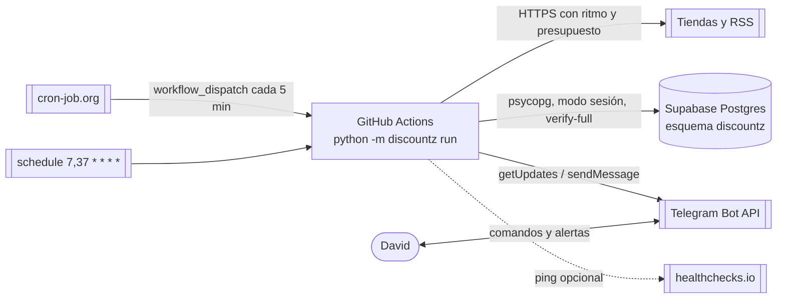

# Arquitectura de discountZ

## Contexto
Monitor **personal** de ofertas para David (Colombia). Rastrea tiendas colombianas (COP) y de EE. UU. que envían a casillero (USD), filtra descuentos inflados con un histórico propio y avisa por Telegram. Escala: decenas a pocos cientos de productos, un solo usuario, costo $0. Diseño completo: `docs/superpowers/specs/2026-10-13-discountz-v1-design.md`; decisiones en `docs/decisions/`.

Sistemas externos: GitHub Actions (cómputo), cron-job.org (disparo cada 5 min), Supabase Postgres (estado), Telegram Bot API (alertas y comandos), tiendas (VTEX ×4, Amazon US, Newegg, Walmart, Best Buy) y el RSS de Slickdeals.

## Contenedores

## Estilo y módulos
Monolito modular hexagonal-lite **síncrono** (ADR 0001). Paquete `src/discountz/`:

| Módulo | Responsabilidad |
|---|---|
| `domain/` | Puro: `Money`, modelo, `SafeUrl`, segmentos, estadísticos, guardas, `evaluate`, `decide`, comandos, planificador, salud. Sin I/O, reloj ni azar del sistema |
| `infra/` | HTTP (`PacedClient` como Decorator), BD (Repository de funciones), migraciones, Telegram, logs, healthchecks |
| `sources/` | Contrato `Source`, registro (`SOURCES`, `route_url`), detección de bloqueos y un adaptador por plataforma |
| `app/` | Casos de uso del ciclo: bandeja de entrada, recolección, confirmación, composición, entrega, mantenimiento, render |
| `__main__.py` | Composition root y CLI: `run`, `migrate`, `check-config`, `record-fixture` |

Regla de dependencias `app → sources → infra → domain`, comprobada por import-linter en pre-commit y CI:

| Contrato | Tipo | Qué impide |
|---|---|---|
| «Capas» | `layers` | Que una capa importe otra superior |
| «Dominio puro» | `forbidden` | Que `domain` importe `httpx`, `curl_cffi`, `psycopg`, `selectolax`, `pydantic`, `pydantic_settings` o `defusedxml` |
| «Adaptadores independientes» | `independence` | Que un adaptador de `sources/` importe otro |

Además, ruff `TID251` prohíbe `datetime.now`, `utcnow`, `date.today`, `time.time` y `random.random` fuera de `__main__.py` e `infra/http.py`, y ruff `DTZ` prohíbe los datetime naive: `now` se calcula una vez y viaja como parámetro.

## Modelo de datos
Esquema `discountz` (migración `0001_init`):

- `source`: catálogo de fuentes con breaker, salud, rampa y cuarentena.
- `source_hourly_stat`: contadores por hora (presupuesto de 24 h, salud, `/estado`).
- `listing`: una variante vendible en una fuente (`UNIQUE (source, external_id)`), último precio, mínimo histórico robusto, `hot_until`.
- `price_segment`: histórico por segmentos de estado constante, PK `(listing_id, started_at)`, un solo segmento abierto por listing.
- `watch` (seguimiento `pNN`) y `search` (búsqueda `bNN`).
- `alert`: hecho de dominio con `UNIQUE (listing_id, segment_started_at, kind)`.
- `outbox`: todo mensaje saliente con `dedup_key` único.
- `bot_state`, `run_lease`, `run`: singletons de operación, lease con TTL y registro de ciclos.
- `schema_migrations`: versión y sha256 de cada migración aplicada.

Dinero en `bigint` de unidad menor (COP exponente 0, USD exponente 2), porcentajes en puntos básicos e instantes en `timestamptz` UTC.

## Flujos clave
1. **Ciclo** (`python -m discountz run`, spec §1.3):
   1. Arranque: `now`, configuración validada, logs con redacción.
   2. Conexión a la BD (3 intentos) y verificación de `SCHEMA_VERSION`.
   3. Lease con TTL de 16 min; si está tomado, `skipped_locked`.
   4. Registro del `run` y recuperación del outbox atascado.
   5. Bandeja de entrada de Telegram (comandos idempotentes; nunca HTTP a tiendas).
   6. Plan puro por fuente: breaker, presupuestos, prioridades y modo caliente.
   7. Recolección por turnos rotativos: fetch → histórico → `evaluate()` → transacción corta.
   8. Confirmación por fuente (tormenta, ruta independiente o persistencia) y creación de alertas.
   9. Composición al outbox, segunda pasada de la bandeja y entrega (≤ 15 mensajes).
   10. Mantenimiento diario, resumen de las 08:00, contadores, cierre y liberación del lease.
2. **Comando `/seguir`**: crea un `watch` pendiente sin HTTP → el plan lo resuelve → la primera lectura crea el `listing` y encola la respuesta.
3. **Feed de Slickdeals**: una tarea `feed` baja el RSS una vez para todas las búsquedas `source='slickdeals'` vencidas → cada lead que coincide y apunta a una tienda activa (sin red: `href`, `u2=` o `data-aps-asin`) encola en memoria una lectura de ficha en esa tienda, antes que sus demás tareas → `evaluate(origin="lead")` puede dar `COMMUNITY_DEAL`. Los leads no se guardan.

## Atributos de calidad
1. **Corrección de alertas**: ninguna alerta por un error de parseo o un descuento inflado (guardas G1-G14, confirmación independiente, tabla U01-U37).
2. **Costo**: $0 (Actions público, Supabase free < 500 MB).
3. **Frescura**: latencia de alerta ~5-8 min (disparo externo, modo caliente).
4. **Seguridad**: repo y logs públicos sin secretos ni datos personales; mínimo privilegio en BD; Telegram solo del dueño.
5. **Robustez**: cada fuente aislada (breaker persistido); outbox y bandeja idempotentes.
6. **Mantenibilidad**: dominio puro con TDD; agregar una tienda no toca `domain/` ni `app/`.

## Riesgos y deuda técnica
- Relámpagos más cortos que la cadencia efectiva se pierden · aceptado.
- Producto descubierto durante una inflación sin histórico previo puede dar `GOOD_DEAL` con `short_history` (U05) · aceptado.
- Promociones recurrentes que ocupan > 10 % del tiempo no se avisan, salvo con objetivo (U33) · aceptado.
- `R = mín(…)` da falsos negativos en mercados al alza · modo `recent` en v1.1 si hay > 3 reportes.
- Una tienda sin ruta independiente nunca confirma un patrón 10^k (U12) · aceptado.
- IPs de Azure: cualquier tienda puede volverse inviable sin proxies · breaker + salud lo hacen visible; plan B local.
- Términos de uso de Actions y de las tiendas · ritmo conservador, sin evasión.
- Un mensaje duplicado si el proceso cae entre la API de Telegram y el commit · aceptado (at-least-once).
- Comandos perdidos tras más de 24 h de caída · healthchecks avisa.
- Newegg y las fichas de Best Buy no responden a la nube de desarrollo: sus fixtures son sintéticas y hay que medirlas desde Actions antes de confiar en ellas · Walmart y Best Buy siguen detrás de `/fuente on`.
